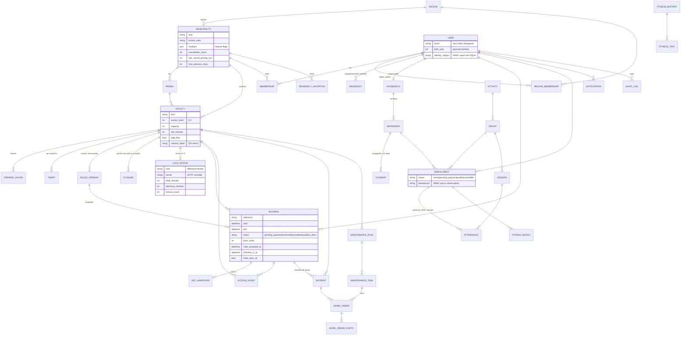

# Modelo de datos

Todas as entidades dun concello levan `municipality` (illamento multi-concello). Diagrama
simplificado (só campos principais).

## Notas

- **Normas versionadas:** `RulesVersion` é inmutable; cada reserva garda a versión aceptada e a data.
- **Datos de menores:** só nome e ano; inscrición só co consentimento `data`; o esforzo e as probas
  só co consentimento `performance`.
- **Auditoría:** `AuditLog` rexistra as accións sensibles (pagos, cancelacións, cambios de normas,
  exportacións, aperturas remotas, consentimentos).
- **Táboas de integración simulada** (`DevMail`, `OutboundMessage`, `FakePayment`) só se usan en
  desenvolvemento/demostración.
