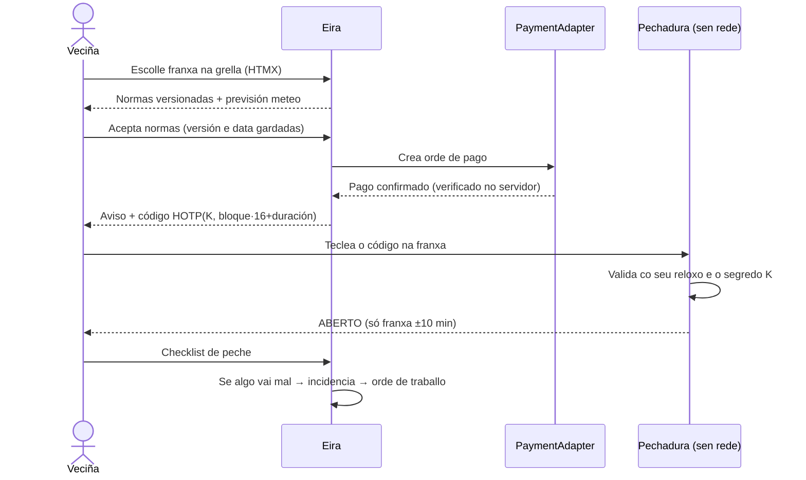
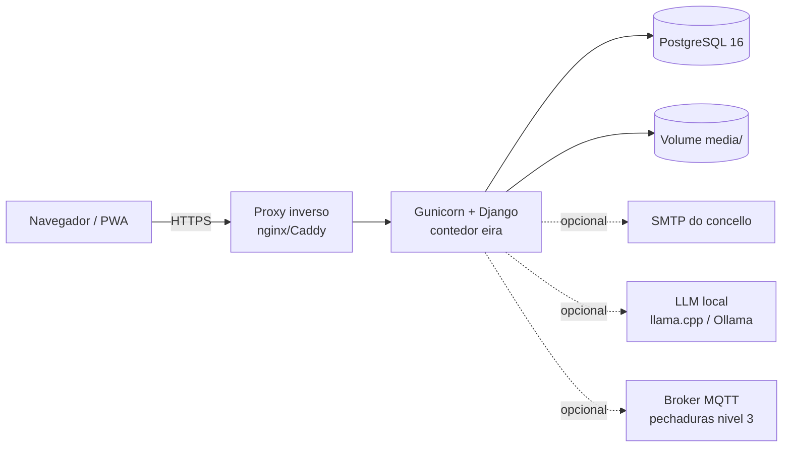

# Visión xeral da arquitectura

Eira é un **monolito modular** en Django: unha soa aplicación fácil de despregar e manter por un
concello ou unha deputación, dividida en módulos con responsabilidades claras. Todo o externo vai
detrás de **adaptadores** intercambiables con implementación simulada.

## Módulos

```mermaid
flowchart LR
  subgraph Web["Interface web (HTML no servidor + HTMX, PWA)"]
    CIT[Veciñanza]:::u
    ADM[Concello /xestion/]:::u
    OPE[Operario /operario/]:::u
    MON[Monitor /monitor/]:::u
    DEP[Deputación /rexion/]:::u
  end
  API[API REST v1<br/>OpenAPI 3.1]

  subgraph Core["apps/ (Django)"]
    T[tenants<br/>concellos, rexións,<br/>configuración, portabilidade]
    A[accounts<br/>acceso sen contrasinal,<br/>roles, familia, auditoría]
    F[facilities<br/>instalacións, horarios,<br/>peches, tarifas, normas]
    B[bookings<br/>reservas, pagos,<br/>cancelacións, .ics]
    X[access<br/>niveis 0–3,<br/>códigos sen conexión]
    I[incidents<br/>avisos con foto]
    M[maintenance<br/>plans, ordes]
    AC[activities<br/>escolas, asistencia, RPE]
    N[notifications<br/>multicanle]
    AN[analytics<br/>indicadores, observatorio,<br/>datos abertos]
    INT[integrations<br/>adaptadores]
  end

  CIT & ADM & OPE & MON & DEP --> Core
  API --> Core
  B --> X
  B --> N
  I --> M
  X --> INT
  B --> INT
  N --> INT
  A --> INT
  AN --> INT

  subgraph Adapters["Adaptadores (EIRA_ADAPTERS)"]
    MAIL[Correo<br/>DevMailbox · SMTP]
    ID[Identidade<br/>Cl@ve simulada · SAML · Chave365 OIDC]
    PAY[Pagos<br/>FakeRedsys · Redsys]
    LOCK[Pechaduras<br/>Mock MQTT · HTTP]
    WX[Meteo<br/>Fake · MeteoSIX]
    TG[Telegram · Web Push]
    AI[IA opcional<br/>Fake · OpenAI-compatible local]
  end
  INT --> MAIL & ID & PAY & LOCK & WX & TG & AI

  classDef u fill:#E5EFE9,stroke:#2E6A4F
```

## Fluxo principal: da reserva á porta



## Multi-concello

- Cada dato pertence a un concello (`TenantModel.municipality`). As vistas filtran sempre por
  `request.tenant`; os tests de `apps/tenants/tests/test_isolation.py` comproban que un concello non
  ve nin modifica datos doutro (web e API).
- Resolución por ruta `/c/<slug>/`, subdominio `<slug>.dominio` ou dominio propio.
- Configuración por concello: regras de cancelación e antelación, módulos activos (*feature flags*),
  textos legais, cor e escudo.
- Unha **deputación ou mancomunidade** (`Region`) pode aloxar moitos concellos nunha soa instancia,
  comparalos e dar de alta concellos novos en tres pasos.

## Despregamento



- Unha imaxe Docker; `docker compose up` arranca app + PostgreSQL con datos de demo.
- Sen servizos de pago nin dependencias de provedor: todo se pode aloxar no CPD da deputación.
- Tarefas periódicas sen infraestrutura extra (cron do sistema):
  `manage.py generate_work_orders`, `manage.py booking_maintenance` (caducar pagos pendentes e
  marcar non presentadas).

## Decisións clave

Ver [DECISIONS.md](../DECISIONS.md). Resumo: Django 5.2 LTS, HTML no servidor con HTMX (accesible e
mantible), CSP estrita sen JS en liña, galego como idioma fonte, adaptadores con simulación,
illamento por chave foránea con tests.
